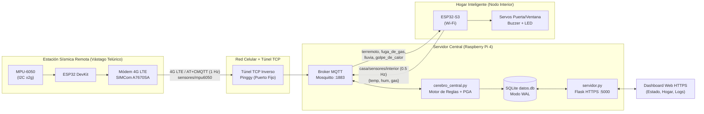

# 🌋 YELLOWSTONE — Sistema IoT de Respuesta a Incidentes y Desastres Naturales

**YELLOWSTONE** es una plataforma IoT *end-to-end* de alerta temprana sísmica, monitoreo ambiental y automatización residencial de emergencias. El sistema desacopla la detección telúrica remota (vía red celular **4G LTE**) de la actuación física en el hogar (vía **Wi-Fi local**), centralizando la toma de decisiones, el almacenamiento concurrente y la interfaz de monitoreo seguro **HTTPS** en una **Raspberry Pi 4**.

---

## 📋 Tabla de Contenidos
1. [Arquitectura General y Flujo de Datos](#-arquitectura-general-y-flujo-de-datos)
2. [Estructura del Repositorio](#-estructura-del-repositorio)
3. [Requisitos de Hardware y Conexiones (Pinout)](#-requisitos-de-hardware-y-conexiones-pinout)
4. [Paso 1: Configuración de la Raspberry Pi (Broker, Python y HTTPS)](#-paso-1-configuración-de-la-raspberry-pi-broker-python-y-https)
5. [Paso 2: Configuración del Túnel TCP (Pinggy)](#-paso-2-configuración-del-túnel-tcp-pinggy)
6. [Paso 3: Ejecución del Servidor Central Unificado](#-paso-3-ejecución-del-servidor-central-unificado)
7. [Paso 4: Carga del Firmware — Nodo Interior (ESP32-S3)](#-paso-4-carga-del-firmware--nodo-interior-esp32-s3)
8. [Paso 5: Carga del Firmware — Nodo Sísmico Remoto (ESP32 + 4G)](#-paso-5-carga-del-firmware--nodo-sísmico-remoto-esp32--4g)
9. [Paso 6: Guía de Pruebas Funcionales (Con y Sin Hardware)](#-paso-6-guía-de-pruebas-funcionales-con-y-sin-hardware)
10. [Umbrales y Matriz de Prioridades](#-umbrales-y-matriz-de-prioridades)
11. [Solución de Problemas Comunes](#-solución-de-problemas-comunes)
12. [Autores](#-autores)

---

## 🏗️ Arquitectura General y Flujo de Datos



### Características Clave de Ingeniería y Seguridad
* **Cálculo de PGA compensado por gravedad:** Aísla la vibración dinámica ($PGA_g$) respecto a la gravedad terrestre ($9.81\text{ m/s}^2$) independientemente de la inclinación del vástago.
* **Retención sísmica sincronizada (60 s):** Ante un sismo Moderado o Alto, tanto la Raspberry Pi como la ESP32-S3 enclavan la alarma y mantienen las salidas de evacuación abiertas durante 60 segundos completos (autonomía *Fail-Safe*).
* **Protección anti-saturación de servos:** Temporizador no bloqueante (`millis()`) de `1500 ms` entre movimientos físicos y filtro de escrituras redundantes.
* **Concurrencia en base de datos:** SQLite configurado en modo **WAL (Write-Ahead Logging)** para permitir escrituras MQTT simultáneas a 1 Hz y lecturas HTTP cada 1.5 s sin bloqueos.
* **Seguridad aplicada:** Autenticación obligatoria en Mosquitto, cifrado de transporte **HTTPS (SSL/TLS)** en Flask, contraseñas almacenadas con **hash criptográfico** (`werkzeug.security`), pestaña administrativa protegida por contraseña y tabla de auditoría de accesos (**Logs**).

---

## 📁 Estructura del Repositorio

> *Nota: Ajusta las rutas de los comandos si organizaste los archivos directamente en la raíz del repositorio.*

```text
YELLOWSTONE/
├── firmware/
│   ├── nodo_interior/
│   │   └── NODO_INTERIOR.ino        # Código ESP32-S3 (DHT11, MQ, Servos, Buzzer, LED)
│   └── nodo_sismico_4g/
│       └── GSM_RASPBERRY.ino        # Código ESP32 + A7670SA + MPU-6050 (4G LTE)
├── server/
│   ├── servidor.py                  # Servidor Flask HTTPS + lanzador del hilo MQTT
│   ├── cerebro_central.py           # Motor de reglas, cálculo PGA y escritura SQLite
│   └── templates/
│       ├── index.html               # Dashboard 4 cuadrantes + pestañas Hogar y Logs
│       └── login.html               # Interfaz de autenticación HTTPS
└── README.md
```

---

## 🔌 Requisitos de Hardware y Conexiones (Pinout)

### 1. Nodo Interior (ESP32-S3)
| Componente | Pin ESP32-S3 | Función / Parámetro |
| :--- | :---: | :--- |
| **Sensor DHT11** | `GPIO 4` | Lectura digital de Temperatura (°C) y Humedad (%) |
| **Sensor de Gas MQ (Salida Analógica)** | `GPIO 1` (ADC1) | Lectura analógica de 12 bits (`0` a `4095`) |
| **Servomotor Ventana** | `GPIO 12` | PWM 50 Hz — Cerrada: `10°` / Abierta: `40°` |
| **Servomotor Puerta** | `GPIO 13` | PWM 50 Hz — Cerrada: `0°` / Abierta: `90°` |
| **Buzzer Activo** | `GPIO 14` | Salida digital (alarma intermitente) |
| **LED Indicador** | `GPIO 16` | Salida digital (fijo en calor / parpadeo en gas o sismo) |

> **Recomendación de potencia:** Alimenta los dos servomotores con una fuente externa de **5V (≥ 2A)** compartiendo el pin **GND** común con la ESP32-S3 para evitar reinicios por caída de tensión (*brownout*).

### 2. Nodo Sísmico Remoto (ESP32 + A7670SA + MPU-6050)
| Componente | Pin ESP32 | Conexión en el Módulo |
| :--- | :---: | :--- |
| **Módem 4G SIMCom A7670SA** | `GPIO 18` (`RX`) | Pin `T-TXD` del A7670SA (115200 baudios) |
| **Módem 4G SIMCom A7670SA** | `GPIO 17` (`TX`) | Pin `R-RXD` del A7670SA (115200 baudios) |
| **Acelerómetro MPU-6050** | `GPIO 21` (`SDA`) | Pin `SDA` (Dirección I2C `0x68`, rango `±2g`) |
| **Acelerómetro MPU-6050** | `GPIO 22` (`SCL`) | Pin `SCL` |

> **Importante:** El módem A7670SA requiere una tarjeta Nano-SIM con plan de datos 4G activo (sin PIN de bloqueo) y alimentación estable de 5V/2A o batería LiPo.

---

## 🚀 Paso 1: Configuración de la Raspberry Pi (Broker, Python y HTTPS)

Ejecuta los siguientes comandos en la terminal de tu **Raspberry Pi 4**:

### 1.1 Clonar el repositorio
```bash
git clone [https://github.com/BalaBlanca/YELLOWSTONE.git](https://github.com/BalaBlanca/YELLOWSTONE.git)
cd YELLOWSTONE
```

### 1.2 Instalar y configurar Mosquitto MQTT con autenticación
```bash
sudo apt update
sudo apt install -y mosquitto mosquitto-clients python3-pip python3-venv openssl
```

Crea el archivo de credenciales MQTT (sustituye `pi_listener` por tu usuario preferido y asigna una contraseña cuando se te solicite):
```bash
sudo mosquitto_passwd -c /etc/mosquitto/passwd pi_listener
```

Configura Mosquitto para escuchar en toda la red local (`0.0.0.0:1883`) y bloquear conexiones anónimas:
```bash
sudo bash -c 'cat << "EOF" > /etc/mosquitto/conf.d/yellowstone.conf
listener 1883 0.0.0.0
allow_anonymous false
password_file /etc/mosquitto/passwd
EOF'
```

Reinicia y verifica que el broker esté activo:
```bash
sudo systemctl enable mosquitto
sudo systemctl restart mosquitto
sudo systemctl status mosquitto --no-pager
```
*(Debe mostrar `active (running)`).*

### 1.3 Instalar dependencias de Python
Navega a la carpeta donde se encuentran `servidor.py` y `cerebro_central.py`:
```bash
python3 -m venv venv
source venv/bin/activate
pip install flask paho-mqtt werkzeug
```

### 1.4 Generar certificados SSL locales (`cert.pem` y `key.pem`) para HTTPS
En la misma carpeta de `servidor.py`, genera un certificado autofirmado válido por 365 días:
```bash
openssl req -x509 -newkey rsa:4096 -nodes -out cert.pem -keyout key.pem -days 365 -subj "/CN=yellowstone.local"
```

### 1.5 Verificar la IP local de la Raspberry Pi
```bash
hostname -I
```
Anota esta dirección IP (por ejemplo, `172.20.10.6`), ya que la necesitarás para el **Nodo Interior** y para abrir el **Dashboard Web**.

---

## 🌐 Paso 2: Configuración del Túnel TCP (Pinggy)

Para que el nodo sísmico 4G pueda enviar paquetes MQTT a través de internet hacia la Raspberry Pi sin necesidad de abrir puertos en el router ni tener IP pública fija, se usa un túnel TCP inverso con **Pinggy**.

### Opción A: Pinggy Pro (Recomendado — Puerto fijo sin expiración)
1. Genera una llave SSH en la Raspberry Pi (solo la primera vez):
   ```bash
   ssh-keygen -t ed25519 -N "" -f ~/.ssh/id_ed25519
   ```
2. Abre una terminal dedicada y lanza el túnel apuntando al puerto `1883` de Mosquitto (reemplaza `TU_TOKEN` por tu token del panel de Pinggy):
   ```bash
   ssh -p 443 -R0:localhost:1883 -o StrictHostKeyChecking=no -o ServerAliveInterval=30 TU_TOKEN+force+tcp@br.pro.pinggy.io
   ```

### Opción B: Pinggy Gratuito (Pruebas rápidas — Caduca cada 60 min)
```bash
ssh -p 443 -R0:localhost:1883 tcp@a.pinggy.io
```

### Obtener la IP numérica del túnel para el módem 4G
Pinggy imprimirá una dirección del tipo `tcp://dominio.a.pinggy.link:PUERTO`. Para acelerar la conexión en el módem A7670SA sin depender de DNS celular, obtén la IP numérica desde otra terminal:
```bash
ping -c 1 dominio.a.pinggy.link
```
Anota la **IP numérica** (ej. `172.233.28.67`) y el **puerto** (ej. `20870`).

---

## 🖥️ Paso 3: Ejecución del Servidor Central Unificado

El archivo `servidor.py` inicializa automáticamente las tablas de SQLite (`datos.db`), levanta el hilo de `cerebro_central.py` en segundo plano y arranca el servidor web HTTPS.

1. Verifica que las credenciales MQTT (`MQTT_USER` y `MQTT_PASS`) en `cerebro_central.py` coincidan con las que creaste en el Paso 1.2.
2. Inicia el sistema desde la carpeta del servidor:
   ```bash
   source venv/bin/activate
   python3 servidor.py
   ```
3. **Verificación en consola:** Deberías ver:
   ```text
   ✅ Cerebro Central conectado a Mosquitto (127.0.0.1:1883)
    * Running on [https://0.0.0.0:5000](https://0.0.0.0:5000)
   ```
4. **Acceso a la interfaz web:** Abre tu navegador en `https://<IP_RASPBERRY>:5000` (acepta la advertencia de certificado autofirmado).
   * **Usuario inicial por defecto:** `admin`
   * **Contraseña inicial por defecto:** `admin123`

---

## 🏠 Paso 4: Carga del Firmware — Nodo Interior (ESP32-S3)

1. Abre `NODO_INTERIOR.ino` en **Arduino IDE**.
2. Instala las siguientes librerías desde el Gestor de Librerías:
   * `PubSubClient` (por Nick O'Leary)
   * `DHT sensor library` (por Adafruit) + `Adafruit Unified Sensor`
   * `ESP32Servo` (por Kevin Harrington)
3. Selecciona tu placa **ESP32S3 Dev Module** y actualiza las credenciales al inicio del archivo:
   ```cpp
   const char* WIFI_SSID   = "TU_RED_WIFI";
   const char* WIFI_PASS   = "TU_CONTRASENA_WIFI";
   const char* MQTT_BROKER = "172.20.10.6"; // IP local de tu Raspberry Pi
   ```
   *(Verifica también el usuario y contraseña de MQTT dentro de `reconectarMQTT()`).*
4. Compila, sube el código y abre el **Monitor Serial a 115200 baudios**.
5. **Verificación:** Cada 2 segundos aparecerá:
   ```text
   🚀 [MQTT TX] casa/sensores/interior -> {"temp":23.4,"hum":58.0,"gas":412}
   ```

---

## 📡 Paso 5: Carga del Firmware — Nodo Sísmico Remoto (ESP32 + 4G)

1. Abre `GSM_RASPBERRY.ino` en **Arduino IDE** (no requiere librerías externas; usa `<Wire.h>` nativo para máxima estabilidad).
2. Selecciona tu placa **ESP32 Dev Module** y edita el bloque de red celular y túnel:
   ```cpp
   const char APN[]         = "web.vmovil.co"; // Cambia según tu operador (Claro, Movistar, Tigo, Virgin)
   const char MQTT_BROKER[] = "tcp://IP_DEL_TUNEL:PUERTO_DEL_TUNEL";
   const char MQTT_USER[]   = "pi_listener";
   const char MQTT_PASS[]   = "TU_PASS_MQTT";
   ```
3. Compila, sube el código y abre el **Monitor Serial a 115200 baudios**.
4. **Verificación:** Verás el arranque del MPU-6050, el registro 4G LTE (`AT+CNMP=38`), la conexión al broker y envíos cada **1 segundo**:
   ```text
   ✅ Sensor MPU-6050 inicializado correctamente en I2C (0x68).
   ✅ ¡CONECTADO EXITOSAMENTE AL BROKER DE LA RASPBERRY PI!
   🚀 [4G TX -> RPi] {"x":0.04,"y":-0.11,"z":9.85}
   ```
   *(El firmware también acepta los comandos manuales `PUB` y `RECONN` escritos directamente en el Monitor Serial).*

---

## 🧪 Paso 6: Guía de Pruebas Funcionales (Con y Sin Hardware)

### 6.1 Pruebas rápidas de simulación sin hardware (desde la Raspberry Pi)
Si deseas validar `cerebro_central.py`, el Dashboard Web y los actuadores sin activar los sensores físicos, puedes inyectar tramas JSON directamente al broker con `mosquitto_pub`:

* **Simular Terremoto de Riesgo Alto ($PGA \ge 0.85\,g$):**
  ```bash
  mosquitto_pub -h 127.0.0.1 -u pi_listener -P TU_PASS_MQTT -t "sensores/mpu6050" -m '{"x":8.5,"y":9.2,"z":15.4}'
  ```
  *Resultado esperado:* La web cambia a rojo pulsante **`Riesgo Alto (59s)`**, Puerta y Ventana pasan a **`ABIERTA`**, y la ESP32-S3 abre ambos servos y hace parpadear el LED/buzzer cada 150 ms durante 60 segundos.

* **Simular Fuga de Gas (sin lluvia):**
  ```bash
  mosquitto_pub -h 127.0.0.1 -u pi_listener -P TU_PASS_MQTT -t "casa/sensores/interior" -m '{"temp":24.0,"hum":55.0,"gas":2200}'
  ```
  *Resultado esperado:* Alerta de gas en rojo, **Ventana abierta (`40°`)**, **Puerta cerrada (`0°`)** y alarma intermitente cada 400 ms.

* **Simular Fuga de Gas + Lluvia simultáneos:**
  ```bash
  mosquitto_pub -h 127.0.0.1 -u pi_listener -P TU_PASS_MQTT -t "casa/sensores/interior" -m '{"temp":20.0,"hum":89.0,"gas":2200}'
  ```
  *Resultado esperado:* La humedad cambia a **azul rey**, la **Ventana se cierra (`10°`)** para evitar entrada de agua y la **Puerta se abre (`90°`)** para ventilar el gas.

* **Simular Golpe de Calor:**
  ```bash
  mosquitto_pub -h 127.0.0.1 -u pi_listener -P TU_PASS_MQTT -t "casa/sensores/interior" -m '{"temp":33.5,"hum":45.0,"gas":300}'
  ```
  *Resultado esperado:* La temperatura cambia a **rojo**, puerta y ventana cerradas, buzzer apagado y **LED encendido fijo**.

### 6.2 Pruebas de seguridad en la Interfaz Web
1. **Pestaña `Hogar`:** Haz clic en **Hogar**, ingresa la contraseña de administrador (`admin123`) para desbloquear el panel y crea una nueva cuenta familiar (ej. `familiar1`).
2. **Validación de Hash:** Cierra sesión e inicia sesión con la cuenta recién creada.
3. **Pestaña `Logs`:** Verifica que aparezca el registro con el usuario, dirección IP, evento (`Creó cuenta familiar`, `Acceso exitoso (Hash + HTTPS)`) y fecha/hora exacta.

---

## 📊 Umbrales y Matriz de Prioridades

### Umbrales Calibrados (`cerebro_central.py`)
| Variable | Umbral | Acción / Estado |
| :--- | :--- | :--- |
| **PGA Sísmico** | `< 0.150 g` | Todo bien (Verde) |
| **PGA Sísmico** | `0.150 g – 0.349 g` | Riesgo Leve (Amarillo — solo registro) |
| **PGA Sísmico** | `0.350 g – 0.849 g` | Riesgo Moderado (Naranja — **Alarma 60 s**) |
| **PGA Sísmico** | `≥ 0.850 g` | Riesgo Alto (Rojo pulsante — **Alarma 60 s**) |
| **Gas (MQ ADC)** | `≥ 1600` (de 4095) | Alerta de Fuga de Gas |
| **Temperatura** | `≥ 30.0 °C` | Alerta de Golpe de Calor (Número en rojo) |
| **Humedad** | `≥ 82.0 %` | Inferencia de Lluvia (Número en azul rey) |

### Jerarquía de Actuación (`NODO_INTERIOR.ino`)
| Prioridad | Incidente Activo | Ventana | Puerta | Buzzer | LED |
| :---: | :--- | :---: | :---: | :---: | :---: |
| **1** | **Terremoto** *(retención 60 s)* | Abierta (`40°`) | Abierta (`90°`) | Parpadeo `150 ms` | Parpadeo `150 ms` |
| **2** | **Fuga de Gas + Lluvia** | Cerrada (`10°`) | Abierta (`90°`) | Parpadeo `400 ms` | Parpadeo `400 ms` |
| **3** | **Solo Fuga de Gas** | Abierta (`40°`) | Cerrada (`0°`) | Parpadeo `400 ms` | Parpadeo `400 ms` |
| **4** | **Golpe de Calor** | Cerrada (`10°`) | Cerrada (`0°`) | Apagado | Encendido fijo |
| **5** | **Solo Lluvia** | Cerrada (`10°`) | Cerrada (`0°`) | Apagado | Apagado |
| **6** | **Estado Normal** | Cerrada (`10°`) | Cerrada (`0°`) | Apagado | Apagado |

---

## 🛠️ Solución de Problemas Comunes

* **Error `Connection refused` o `rc=5` en los ESP32:** Verifica que el servicio Mosquitto esté corriendo (`sudo systemctl status mosquitto`) y que el usuario/contraseña coincidan con `/etc/mosquitto/passwd`.
* **El servo de la ventana gira al revés en tu maqueta:** Invierte los valores de `#define VENTANA_CERRADA` y `#define VENTANA_ABIERTA` al inicio de `NODO_INTERIOR.ino`.
* **El MPU-6050 marca `Riesgo Leve` estando quieto:** Algunos sensores tienen un *offset* elevado en el eje Z. Aumenta ligeramente `UMBRAL_SISMO_LEVE` (ej. de `0.150` a `0.200`) en `cerebro_central.py`.
* **Error `Permission denied (publickey)` en Pinggy Pro:** Ejecuta `ssh-keygen -t ed25519 -N "" -f ~/.ssh/id_ed25519` en la máquina desde la que lanzas el túnel SSH.
* **La ESP32-S3 se reinicia al mover los servos:** Separa la alimentación de 5V de los servos respecto al puerto USB de la ESP32-S3 manteniendo unidas las tierras (`GND`).

---

## 👥 Autores

Proyecto desarrollado para la asignatura **IoT y Ciberseguridad (ICCS)** en la **Escuela Colombiana de Ingeniería Julio Garavito** (Bogotá, Colombia):

* **Dickson Andrés Trujillo Torres** — `dickson.trujillo-t@mail.escuelaing.edu.co`
* **Juan Esteban Cortés Guantiva** — `juan.cortes-gu@mail.escuelaing.edu.co`
* **Arianne Patiño García** — `arianne.patino-g@mail.escuelaing.edu.co`
